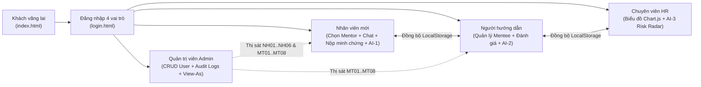

# OnboardAI – Hành trình hội nhập nhân sự mới (BTL-20)

> **Học phần:** PHÁT TRIỂN ỨNG DỤNG WEB CƠ BẢN – CSE122 (Trường Đại học Thủy Lợi – Khoa CNTT)  
> **Mã đề tài:** BTL-20 (Lĩnh vực: Nhân sự / HRTech)  
> **Nhóm thực hiện:** Nhóm 10 (2 Thành viên thực hiện toàn bộ khối lượng dự án: **SV1 – Trưởng nhóm** & **SV2**)  
> **Repository GitHub:** [https://github.com/xalambay07-svg/cse122-onboardai-nhom10](https://github.com/xalambay07-svg/cse122-onboardai-nhom10)  
> **Bảng Kanban Trello:** [[CSE122 - BTL20] OnboardAI - Nhóm 10](https://trello.com/b/J0c8nZ2l) *(Xem bản trực quan 4 tuần tại [`trello-kanban.html`](trello-kanban.html) & [`docs/QUY_TRINH_TRELLO_KANBAN.md`](docs/QUY_TRINH_TRELLO_KANBAN.md))*

---

## Ngữ cảnh

Trong các doanh nghiệp công nghệ và dịch vụ hiện đại, **giai đoạn hội nhập nhân sự mới (Employee Onboarding)** kéo dài trong 60 ngày thử việc đầu tiên là giai đoạn quyết định tỷ lệ gắn bó lâu dài của nhân viên. Mỗi nhân sự mới cần hoàn thành hàng chục đầu việc theo 4 mốc **Ngày đầu (Day 1) – Tuần 1 (Week 1) – Tháng 1 (Month 1) – Tháng 2 (Month 2)**: nhận bàn giao thiết bị IT, ký hồ sơ pháp lý, tìm hiểu quy chế phúc lợi, kết nối với Người đồng hành (Mentor/Buddy) và hoàn thành nhiệm vụ chuyên môn.

*(Chi tiết tại [`docs/project-proposal.md`](docs/project-proposal.md))*

---

## Phát biểu vấn đề

Quy trình Onboarding truyền thống bằng file Excel, email rời rạc và tài liệu PDF tĩnh đang gây ra 4 điểm nghẽn lớn:
1. **Nhân viên mới (New Hire):** Quá tải thông tin, không biết hỏi ai khi vướng mắc về lương thưởng, bảo hiểm, nghỉ phép; không được lựa chọn Người đồng hành phù hợp và không nắm rõ tiến độ thử việc.
2. **Người hướng dẫn (Mentor):** Khó theo dõi đồng thời nhiều nhân sự mới (Mentee), thiếu công cụ kiểm tra minh chứng hoàn thành công việc và mất thời gian soạn lộ trình riêng cho từng vị trí.
3. **Chuyên viên Nhân sự (HR Specialist):** Thiếu bảng điều khiển trực quan theo thời gian thực; chỉ phát hiện nhân sự mới bị chậm tiến độ khi đã kết thúc kỳ thử việc.
4. **Quản trị viên (System Admin):** Khó kiểm soát phân quyền truy cập (RBAC), trạng thái tài khoản và nhật ký kiểm toán (Audit Logs).

---

## Mục tiêu

1. **Chuẩn hóa lộ trình hội nhập 4 giai đoạn:** Số hóa Checklist công việc kèm cơ chế nộp minh chứng hoàn thành (`Proof Submission`) và tính toán tiến độ `%` tự động.
2. **Liên thông 4 vai trò người dùng khép kín:** Kết nối xuyên suốt *Nhân viên mới – Người hướng dẫn – Chuyên viên HR – Quản trị viên* qua kho dữ liệu đồng bộ `window.OnboardAPI` (`js/api.js` + `assets/data/mock-data.json` + `localStorage`).
3. **Tích hợp 3 tính năng AI thực chất (không trùng lặp):**
   - **AI-1:** Tìm kiếm ngữ nghĩa & Trợ lý giải thích chính sách có trích dẫn nguồn và cơ chế dự phòng chuyển HR khi AI không chắc chắn.
   - **AI-2:** Ghép cặp 8 Người đồng hành theo điểm tương thích (`Match Score %`) & Cá nhân hóa lộ trình Checklist theo vị trí công việc.
   - **AI-3:** Dự báo & Cảnh báo sớm rủi ro hội nhập (`HR Risk Radar`) kết hợp biểu đồ `Chart.js`.
4. **Đảm bảo chuẩn kỹ thuật Frontend:** HTML5 ngữ nghĩa, CSS3 Responsive, Form Validation, bao phủ đầy đủ trạng thái (*Normal, Loading, Empty State + CTA, Error, Success*) và khả năng tiếp cận (Accessibility).

---

## Các vai trò

Hệ thống phục vụ **4 vai trò nghiệp vụ chính** cùng *Khách vãng lai* (Xem phân tích 10 câu hỏi bắt buộc cho từng vai trò tại [`docs/roles-and-features.md`](docs/roles-and-features.md)):

| Vai trò | Tài khoản Kiểm thử (Mật khẩu: `123456`) | Mục tiêu & Chức năng cốt lõi |
| :--- | :--- | :--- |
| **1. Nhân viên mới (`New Hire`)** | `an.nguyen@onboardai.vn` (`NH01`)<br>`nam.le@onboardai.vn` (`NH02`)<br>`chi.pham@onboardai.vn` (`NH03`) | Xem tiến độ `%`, chọn trong **8 Người đồng hành** do AI gợi ý (kèm SĐT, Zalo, ảnh chân dung), chat trực tiếp với Mentor, hoàn thành Checklist & nộp minh chứng, hỏi đáp Trợ lý **AI-1**. |
| **2. Người hướng dẫn (`Mentor`)** | `mentor@onboardai.vn` (`MT01`)<br>`minh.nguyen@onboardai.vn` (`MT02`)<br>`tuan.le@onboardai.vn` (`MT04`) | Theo dõi danh sách Mentee đang phụ trách, tìm kiếm/lọc theo trạng thái tiến độ, duyệt minh chứng, chấm điểm đánh giá định kỳ 1-on-1 và dùng **AI-2** gợi ý lộ trình công việc. |
| **3. Chuyên viên Nhân sự (`HR`)** | `hr@onboardai.vn`<br>`huy.pham@onboardai.vn` | Giám sát KPI toàn công ty, xem biểu đồ `Chart.js`, phát hiện sớm nhân sự có nguy cơ trễ hạn qua **AI-3 Risk Radar**, gửi nhắc nhở can thiệp và xuất báo cáo CSV. |
| **4. Quản trị viên (`Admin`)** | `admin@onboardai.vn`<br>`son.do@onboardai.vn` | Quản lý vòng đời tài khoản (Thêm/Sửa/Khóa/Xóa mềm có hoàn tác), kiểm soát ma trận RBAC, xem Nhật ký kiểm toán (`Audit Logs`) và sử dụng **Chế độ thị sát đa người dùng (`View-As`)** cho cả 6 New Hires (`NH01`..`NH06`) và 8 Mentors (`MT01`..`MT08`). |

*(Bảng tra cứu đầy đủ 18 tài khoản đăng nhập nằm tại [`docs/TAI_KHOAN_DANG_NHAP.md`](docs/TAI_KHOAN_DANG_NHAP.md))*

---

## Luồng người dùng



---

## Bảng kiểm kê màn hình

*(Xem bảng đầy đủ theo mẫu Phụ lục B tại [`docs/screen-inventory.md`](docs/screen-inventory.md))*

| # | Vai trò | Mục tiêu người dùng | Nhiệm vụ người dùng | Màn hình | Tệp | CRUD | Trạng thái | AI | Phụ trách | Công việc | Nhánh | OBS |
|:---:|:---|:---|:---|:---|:---|:---:|:---|:---|:---:|:---:|:---|:---:|
| 1 | **Dùng chung** | Tìm hiểu giải pháp | Xem tính năng & quy trình 4 giai đoạn | Trang chủ giới thiệu | [`index.html`](index.html) | R | Bình thường · Đang tải | Giới thiệu 3 AI | **SV1** | `T08` | `huy/feature/newhire-checklist` | `OBS-01` |
| 2 | **Dùng chung** | Xác thực vai trò | Đăng nhập & kiểm tra hợp lệ biểu mẫu | Cổng đăng nhập 4 vai trò | [`login.html`](login.html) | C/R | Bình thường · Lỗi · Bị khóa | – | **SV2** | `T08`, `T20` | `feat/sv2-data-mentor` | `OBS-02` |
| 3 | **New Hire** | Theo dõi tiến độ & chọn Mentor | Chọn trong 8 Mentor AI gợi ý & Chat trực tiếp | Dashboard Nhân viên mới | [`newhire-onboarding-dashboard.html`](newhire-onboarding-dashboard.html) | C/R/U | Chưa có Mentor (Rỗng) · Đang chat · Hoàn thành | **AI-2:** Ghép cặp 8 Mentor | **SV1** | `T09`, `T14`, `T21` | `huy/feature/newhire-checklist` | `OBS-01` |
| 4 | **New Hire** | Hoàn thành nhiệm vụ thử việc | Lọc việc 4 giai đoạn, nộp minh chứng | Hành trình & Checklist công việc | [`newhire-checklist.html`](newhire-checklist.html) | C/R/U | Chưa làm · Đã nộp · Hoàn thành · Rỗng | AI Guide & AI Quiz | **SV1** | `T09`, `T13` | `huy/feature/newhire-checklist` | `OBS-01` |
| 5 | **New Hire** | Tra cứu quy chế nội bộ | Đặt câu hỏi tự nhiên, xem trích dẫn nguồn | Trợ lý AI Chính sách | [`newhire-ai-help.html`](newhire-ai-help.html) | C/R | Đang tải · Có kết quả · Không chắc chắn (Fallback HR) | **AI-1:** Tìm kiếm ngữ nghĩa | **SV1** | `T15` | `huy/feature/newhire-checklist` | `OBS-01` |
| 6 | **Mentor** | Kèm cặp nhân sự mới | Lọc Mentee, đánh giá & gợi ý việc theo vị trí | Quản lý danh sách Mentee | [`mentor-mentee-list.html`](mentor-mentee-list.html) | C/R/U | Đúng tiến độ · Cần chú ý · Nguy cơ trễ hạn · Rỗng | **AI-2:** Cá nhân hóa Checklist | **SV2** | `T10`, `T16`, `T17` | `feat/sv2-data-mentor` | `OBS-02` |
| 7 | **Dùng chung** | Quản lý hồ sơ cá nhân | Cập nhật thông tin liên hệ & đổi mật khẩu | Hồ sơ cá nhân | [`profile.html`](profile.html) | R/U | Bình thường · Thành công · Lỗi kiểm tra hợp lệ | – | **SV2** | `T10` | `feat/sv2-data-mentor` | `OBS-02` |
| 8 | **HR** | Giám sát toàn công ty | Xem biểu đồ `Chart.js` & can thiệp nhân sự trễ hạn | Trung tâm điều hành HR | [`hr-dashboard.html`](hr-dashboard.html) | C/R/U | Bình thường · Rỗng · Cảnh báo rủi ro · Đã can thiệp | **AI-3:** Dự báo rủi ro (`Risk Radar`) | **SV1** | `T11`, `T18` | `fix/sv3-data-sync-hr-admin` | `OBS-03` |
| 9 | **Admin** | Quản trị hệ thống & RBAC | CRUD tài khoản, xem Audit Logs, thị sát đa tài khoản | Quản trị tài khoản & Phân quyền | [`admin-user-management.html`](admin-user-management.html) | C/R/U/D | `Active` · `Pending` · `Locked` · Rỗng | Kiểm tra tự động cấu hình | **SV1** | `T11`, `T19`, `T22` | `fix/sv3-data-sync-hr-admin` | `OBS-03` |

---

## Tính năng AI

Dự án triển khai **3 mô-đun AI thuộc 3 nhóm khác nhau** kèm đầy đủ giải thích kết quả (*Explainability*) và xử lý khi AI không chắc chắn (*Fallback* – chi tiết tại [`docs/roles-and-features.md`](docs/roles-and-features.md)):

1. **AI-1 – Tìm kiếm ngữ nghĩa & Trợ lý giải thích chính sách (`newhire-ai-help.html` – SV1 phụ trách):**
   - Phân tích câu hỏi ngôn ngữ tự nhiên, hiển thị trạng thái đang xử lý (*Loading*), trả về câu trả lời kèm **Độ tin cậy (%)** và **Điều khoản trích dẫn**.
   - **Trải nghiệm khi AI thất bại / không chắc chắn:** Khi câu hỏi mơ hồ (Zone 2) AI gợi ý câu hỏi làm rõ; khi ngoài phạm vi dữ liệu (Zone 3) AI thông báo *"Không đủ dữ liệu chính sách"* và cung cấp nút **[Chuyển câu hỏi cho HR]**.
2. **AI-2 – Ghép cặp Người đồng hành & Cá nhân hóa lộ trình (`newhire-onboarding-dashboard.html`, `mentor-mentee-list.html` – SV1 & SV2 phối hợp):**
   - Phân tích phòng ban và chuyên môn của nhân sự mới để đề xuất **8 Người đồng hành (`MT01`..`MT08`)** kèm điểm phù hợp (`Match Score %`) và lý do ghép cặp; người dùng toàn quyền chấp nhận hoặc tự chọn/đổi Mentor khác.
   - Hỗ trợ Mentor tự động sinh danh sách đầu việc chuyên môn theo vị trí.
3. **AI-3 – Dự báo & Cảnh báo sớm rủi ro hội nhập (`hr-dashboard.html` – SV1 phụ trách):**
   - Tự động quét tiến độ và các nhiệm vụ quá hạn để phân loại mức độ rủi ro (`Đúng tiến độ`, `Cần chú ý`, `Nguy cơ trễ hạn`), giải thích nguyên nhân và mở ngăn kéo can thiệp cho HR.

---

## Công nghệ

- **Giao diện & Bố cục:** HTML5 Semantic (`header`, `nav`, `main`, `section`, `article`, `aside`), CSS3 Custom Properties (`css/style.css`), Tailwind CSS Utility & Bento Grid Responsive.
- **Lập trình Tương tác & Dữ liệu:** Vanilla JavaScript (ES6+), DOM Manipulation, Form Validation, `window.OnboardAPI` (`js/api.js`), JSON (`assets/data/mock-data.json`) và `localStorage` (`ONBOARDAI_DB_V4`).
- **Trực quan hóa Dữ liệu:** Thư viện biểu đồ `Chart.js` (Bar Chart & Doughnut Chart trên `hr-dashboard.html`).
- **Quản lý Mã nguồn & Dự án:** Git, GitHub Flow (`main`, `dev`, `feature/*`, `fix/*`) và Trello Kanban.

---

## Thành viên nhóm

> *(Ghi chú: Do thành viên thứ 3 nghỉ học, toàn bộ khối lượng công việc của dự án được **SV1 – Trưởng nhóm** đảm nhận gộp cùng phân hệ New Hire, HR & Admin).*

| STT | Thành viên | Vai trò trong nhóm | Phân hệ & Tính năng phụ trách | Nhánh Git | Video OBS |
|:---:|:---|:---|:---|:---|:---:|
| 1 | **SV1 (Huy)** | **Trưởng nhóm – UI/UX, New Hire, HR & Admin Lead** | • Phân hệ Khách & Nhân viên mới (`index.html`, `newhire-*`)<br>• Phân hệ HR & Admin (`hr-dashboard.html`, `admin-user-management.html`, Chế độ thị sát `View-As`)<br>• Tính năng **AI-1**, **AI-2 (Mentor Matching & Chat)**, **AI-3 (HR Risk Radar)** | `huy/feature/newhire-checklist`<br>`fix/sv3-data-sync-hr-admin` | `OBS-01`<br>`OBS-03` |
| 2 | **SV2 (Hoàng)** | **Core Data & Mentor Lead** | • Kiến trúc dữ liệu (`js/api.js`, `assets/data/mock-data.json`)<br>• Đăng nhập & Hồ sơ (`login.html`, `profile.html`)<br>• Phân hệ Người hướng dẫn (`mentor-mentee-list.html`) & **AI-2 (Checklist Personalizer)** | `feat/sv2-data-mentor` | `OBS-02` |

---

## Phân công công việc

Chi tiết lát cắt dọc và trách nhiệm chéo của từng thành viên được lưu tại [`docs/team-assignment.md`](docs/team-assignment.md) và [`docs/QUY_TRINH_TRELLO_KANBAN.md`](docs/QUY_TRINH_TRELLO_KANBAN.md):
- **SV1 (Huy – Trưởng nhóm):** Đảm nhận toàn bộ phân hệ Khách, Nhân viên mới (`index.html`, `newhire-onboarding-dashboard.html`, `newhire-checklist.html`, `newhire-ai-help.html`), phân hệ Nhân sự (`hr-dashboard.html` + `Chart.js`), Quản trị viên (`admin-user-management.html`), **Chế độ thị sát đa người dùng (`View-As`)**, mô-đun **AI-1** & **AI-3**, cùng trách nhiệm chéo về **Design System (`css/style.css`), Quản trị Git/Trello & Tích hợp hệ thống**.
- **SV2 (Hoàng):** Đảm nhận kiến trúc dữ liệu (`js/api.js`, `assets/data/mock-data.json`), đăng nhập (`login.html`), hồ sơ (`profile.html`), phân hệ Người hướng dẫn (`mentor-mentee-list.html`), mô-đun **AI-2**, cùng trách nhiệm chéo về **Form Validation & Đồng bộ dữ liệu LocalStorage**.

---

## Quy trình Git

Nhóm tuân thủ quy trình GitHub Flow chuẩn (Xem chi tiết tại [`docs/TONG_QUAN_VA_QUY_TRINH_PHOI_HOP.md`](docs/TONG_QUAN_VA_QUY_TRINH_PHOI_HOP.md)):
1. Nhận thẻ công việc trên bảng Trello Kanban (`T01` $\rightarrow$ `T24`).
2. Tạo nhánh tính năng từ `dev` (`huy/feature/newhire-checklist`, `feat/sv2-data-mentor`, `fix/sv3-data-sync-hr-admin`).
3. Ghi nhận thay đổi theo chuẩn Conventional Commits (`feat:`, `fix:`, `style:`, `perf:`, `docs:`).
4. Tạo Pull Request (PR #1 $\rightarrow$ PR #4), đánh giá chéo (Review) và hợp nhất vào `dev` $\rightarrow$ kiểm thử tích hợp $\rightarrow$ phát hành lên `main`.

---

## Figma / Canva

- **Tệp liên kết thiết kế:** [`design/figma-link.txt`](design/figma-link.txt)
- **Thư mục ảnh xuất mockup:** [`design/mockups/`](design/mockups/README.md)

---

## Demo

### Cách chạy dự án tại máy cục bộ:
1. **Dùng VS Code Live Server hoặc Python HTTP Server:**
   ```bash
   python -m http.server 8080
   ```
2. Mở trình duyệt tại:
   - Trang chủ: `http://localhost:8080/index.html`
   - Đăng nhập 4 vai trò: `http://localhost:8080/login.html`
   - Bảng quá trình Trello 4 tuần: `http://localhost:8080/trello-kanban.html`

---

## Minh chứng OBS

*(Xem kịch bản quay chi tiết từng phút tại [`docs/KICH_BAN_CHI_TIET_3_VIDEO_OBS.md`](docs/KICH_BAN_CHI_TIET_3_VIDEO_OBS.md) và bảng liên kết Commit tại [`docs/obs-evidence.md`](docs/obs-evidence.md))*

| Mã Video | Phân hệ & Tệp trọng tâm | Thành viên | Nội dung giải thích code & Sửa trực tiếp (Live Coding) | Link Video (Drive / YouTube) |
|:---:|:---|:---:|:---|:---:|
| **`OBS-01`** | **Phân hệ Nhân viên mới & AI-1**<br>(`index.html`, `newhire-onboarding-dashboard.html`, `newhire-checklist.html`, `newhire-ai-help.html`) | **SV1 (Huy)** | Giải thích thuật toán AI gợi ý 8 Người đồng hành & Chat trực tiếp, tích chọn hoàn thành Checklist lưu `localStorage`, hỏi đáp trợ lý **AI-1** và sửa trực tiếp giao diện/logic trên code. | [Xem Video OBS 01](https://...) |
| **`OBS-02`** | **Core Data Engine, Phân hệ Mentor & AI-2**<br>(`js/api.js`, `assets/data/mock-data.json`, `login.html`, `mentor-mentee-list.html`, `profile.html`) | **SV2 (Hoàng)** | Giải thích kiến trúc `window.OnboardAPI` & `localStorage`, tìm kiếm/lọc Mentee, kiểm tra hợp lệ biểu mẫu (Form Validation), tính năng **AI-2 (Checklist Personalizer)** và sửa trực tiếp code. | [Xem Video OBS 02](https://...) |
| **`OBS-03`** | **Phân hệ HR, Quản trị viên (Admin) & AI-3**<br>(`hr-dashboard.html`, `admin-user-management.html`, Chế độ thị sát `View-As`) | **SV1 (Huy)** | Giải thích biểu đồ `Chart.js`, thuật toán cảnh báo sớm **AI-3 (HR Risk Radar)**, quản lý CRUD tài khoản, Chế độ thị sát đa người dùng (`NH01`..`NH06`, `MT01`..`MT08`) và sửa trực tiếp code. | [Xem Video OBS 03](https://...) |

---

## Khai báo sử dụng AI

Toàn bộ lịch sử câu lệnh (Prompts), kết quả AI sinh ra, phần chỉnh sửa của sinh viên, cách kiểm chứng và bài học rút ra được trình bày chi tiết theo đúng **Mẫu Phụ lục F** tại tệp:  
👉 [`docs/ai-usage-report.md`](docs/ai-usage-report.md)
