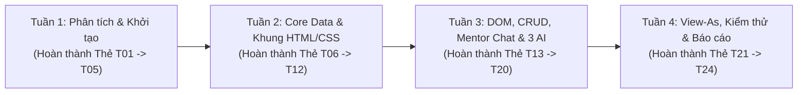

# QUY TRÌNH QUẢN LÝ DỰ ÁN TRÊN TRELLO KANBAN – DỰ ÁN ONBOARDAI (BTL-20)

> **Học phần:** CSE122 – Thiết kế Web Cơ bản (AI-Native Frontend Engineering)  
> **Đề tài:** BTL-20 – **OnboardAI**: Nền tảng Hội nhập Nhân sự Thông minh  
> **Nhóm thực hiện:** Nhóm 10 (3 Thành viên: SV1, SV2, SV3)  
> **Repository GitHub:** `https://github.com/xalambay07-svg/cse122-onboardai-nhom10.git`

---

## 1. Cấu trúc Bảng Trello (6 Cột / Lists Chuẩn Agile Kanban)

Bảng Trello của nhóm được đặt tên là **`[CSE122 - BTL20] OnboardAI - Nhóm 10`** với chế độ hiển thị **Workspace / Public** để Giảng viên có thể kiểm tra trực tiếp. Bảng gồm **6 cột (Lists)** phản ánh luồng công việc từ lúc lập kế hoạch đến khi nghiệm thu:

| STT | Tên Cột trên Trello (List Name) | Mục đích & Quy tắc vận hành |
| :--- | :--- | :--- |
| **Cột 1** | **📌 1. Thông tin Dự án & Quy ước (Project Info)** | Lưu trữ các thẻ cố định: Link GitHub Repo, Link Figma, Quy ước nhánh Git & Commit, Phân công 3 thành viên và Tài khoản Demo. |
| **Cột 2** | **📋 2. Backlog (Danh sách công việc)** | Chứa toàn bộ 24 hạng mục công việc của 4 tuần được bóc tách từ yêu cầu đề bài BTL-20. |
| **Cột 3** | **🎨 3. Tuần 1–2: Thiết kế & Khung UI/Data** | Các thẻ công việc thuộc giai đoạn Phân tích nghiệp vụ, Thiết kế Figma, dựng `css/style.css`, `mock-data.json`, `js/api.js` và khung HTML tĩnh. |
| **Cột 4** | **⚡ 4. Tuần 3: Lập trình DOM, CRUD & 3 AI** | Các thẻ lập trình tương tác JavaScript ES6, LocalStorage CRUD, gợi ý & chọn Mentor, Chat trực tiếp, 3 tính năng AI và Chế độ thị sát đa người dùng (View-As). |
| **Cột 5** | **🔍 5. Kiểm thử & Quay Video OBS (In Review)** | Các thẻ đang được Trưởng nhóm (SV3) review Pull Request trên GitHub, kiểm thử liên thông 4 phân hệ và quay 11 video OBS minh chứng. |
| **Cột 6** | **✅ 6. Đã hoàn thành (Done)** | Các thẻ đã merge thành công vào nhánh `dev` và `main`, vượt qua checklist nghiệm thu và có đầy đủ minh chứng. |

---

## 2. Hệ thống Nhãn màu (Labels) & Phân công Thành viên

### 2.1. Nhãn theo Thành viên phụ trách
- 🟦 **`SV1 - UI/UX & New Hire (Huy)`** *(Màu Xanh dương - Blue)*: Phụ trách Design System (`css/style.css`), Landing Page (`index.html`), Đăng nhập (`login.html`), Dashboard Nhân viên mới (`newhire-onboarding-dashboard.html`), Checklist & Nộp minh chứng (`newhire-checklist.html`), Đề xuất & Chat với Người đồng hành, và trợ lý **AI-1 (Policy Q&A Assistant - `newhire-ai-help.html`)**.
- 🟩 **`SV2 - Core Data & Mentor (Hoàng)`** *(Màu Xanh lá - Green)*: Phụ trách Kiến trúc dữ liệu (`assets/data/mock-data.json`), Data Engine (`js/api.js`), Phân hệ Người hướng dẫn (`mentor-mentee-list.html`), Hồ sơ cá nhân (`profile.html`), và **AI-2 (Checklist Personalizer & Mentor Matching)**.
- 🟪 **`SV3 - DevOps, HR & Admin (Trưởng nhóm)`** *(Màu Tím - Purple)*: Phụ trách Quản trị Git/Trello, Phân hệ Nhân sự (`hr-dashboard.html` + Chart.js), Phân hệ Quản trị viên (`admin-user-management.html`), Chế độ thị sát đa tài khoản (`View-As`), và **AI-3 (Progress Risk Warning / Risk Radar)**.

### 2.2. Nhãn theo Loại công việc & Mức độ ưu tiên
- 🟧 **`Core Data & Architecture`** *(Màu Cam - Orange)*: Các tác vụ nền tảng bắt buộc hoàn thành trước để không chặn (block) thành viên khác.
- 🟥 **`AI Feature (Bắt buộc)`** *(Màu Đỏ - Red)*: 3 tính năng AI cốt lõi của đề tài BTL-20 (`AI-1`, `AI-2`, `AI-3`).
- 🟨 **`UI/UX & Responsive`** *(Màu Vàng - Yellow)*: Thiết kế giao diện, tối ưu cuộn mượt mà, ảnh đại diện chân thực và bố cục Bento Grid.
- 🩵 **`Testing, Git & Báo cáo`** *(Màu Xanh ngọc - Sky)*: Review PR, kiểm thử tích hợp, quay OBS và viết báo cáo tổng kết.

---

## 3. Quá trình Dịch chuyển Thẻ theo 4 Tuần (Sprint Timeline)

Để thể hiện rõ **quá trình làm việc thực tế trên Trello** khi báo cáo với Giảng viên, quá trình vận hành bảng Trello của nhóm diễn ra qua 4 giai đoạn:

1. **Giai đoạn Tuần 1 (Phân tích, Thiết kế & Khởi tạo):**
   - Tạo bảng Trello, thiết lập 6 cột, gắn nhãn và đưa toàn bộ 24 thẻ vào **Backlog**.
   - Kéo các thẻ **T01 → T05** sang cột làm việc và hoàn thành: Phân tích yêu cầu BTL-20, lập danh mục màn hình (Screen Inventory), thiết kế sơ đồ luồng (User Flows), thiết kế Figma Design System và khởi tạo GitHub Repo (`main`, `dev`, các nhánh `feature/*`).
2. **Giai đoạn Tuần 2 (Kiến trúc Dữ liệu & Dựng Khung Giao diện tĩnh):**
   - Kéo các thẻ **T06 → T12** vào thực hiện.
   - SV1 hoàn thiện `css/style.css` trước để SV2 và SV3 đồng bộ biến CSS; SV2 hoàn thiện `assets/data/mock-data.json` và `js/api.js` trước để cung cấp hàm `window.OnboardAPI` cho toàn nhóm.
   - Cả 3 thành viên dựng xong khung giao diện HTML/CSS tĩnh cho toàn bộ 9 màn hình của 4 phân hệ.
3. **Giai đoạn Tuần 3 (Lập trình Tương tác DOM, LocalStorage CRUD & Tích hợp 3 AI):**
   - Kéo các thẻ **T13 → T20** sang cột **Tuần 3: Lập trình DOM, CRUD & 3 AI**.
   - Lập trình xác thực đăng nhập đa vai trò (`login.html`), cập nhật tiến độ & nộp minh chứng (`newhire-checklist.html`), tính năng AI gợi ý Người đồng hành & khung Chat trực tiếp (`newhire-onboarding-dashboard.html`), chấm điểm & phản hồi của Mentor (`mentor-mentee-list.html`), cùng 3 mô-đun **AI-1**, **AI-2**, **AI-3**.
4. **Giai đoạn Tuần 4 (Hoàn thiện View-As, Tối ưu Hiệu năng, Quay Video OBS & Nghiệm thu):**
   - Thực hiện các thẻ **T21 → T24**: Nâng cấp ảnh chân dung Mentor Việt Nam (`mt01.jpg`..`mt08.jpg`), tối ưu hiệu năng cuộn trang (`60fps`), mở rộng **Chế độ thị sát (View-As)** cho phép chọn xem nhiều Nhân sự mới (`NH01`..`NH06`) và nhiều Người hướng dẫn (`MT01`..`MT08`), kiểm thử tích hợp toàn hệ thống, quay 11 video OBS và đóng gói báo cáo.

---

## 4. Chi tiết Toàn bộ Thẻ Công việc trên Trello (24 Cards)

Dưới đây là nội dung chi tiết của từng thẻ để nhóm sử dụng trực tiếp trên bảng Trello hoặc import từ file [`docs/trello-cards-import.csv`](file:///C:/Users/admin/.gemini/antigravity/scratch/onboardai-btl20/docs/trello-cards-import.csv):

### 📌 CỘT 1: THÔNG TIN DỰ ÁN & QUY ƯỚC (PROJECT INFO)

#### Thẻ INFO-01: `[INFO] Tài nguyên Dự án, Nhánh Git & Quy ước Phối hợp Nhóm 10`
- **Thành viên:** Cả nhóm (SV1, SV2, SV3)
- **Nhãn:** `Testing, Git & Báo cáo`
- **Mô tả:**
  - **GitHub Repository:** `https://github.com/xalambay07-svg/cse122-onboardai-nhom10.git`
  - **Nhánh chính:** `main` (Production), `dev` (Integration)
  - **Nhánh thành viên:** `huy/feature/newhire-checklist`, `feat/sv1-ui-newhire`, `feat/sv2-data-mentor`, `feat/sv3-hr-admin`, `fix/sv3-data-sync-hr-admin`
  - **Quy tắc Vàng:** Không sửa trực tiếp trên `main`; mọi thay đổi dữ liệu đều gọi qua `window.OnboardAPI` (`js/api.js`) để đồng bộ LocalStorage (`onboardai_db_v1`).
- **Checklist:**
  - [x] Thống nhất quy tắc đặt tên nhánh & chuẩn Conventional Commits (`feat:`, `fix:`, `style:`, `docs:`)
  - [x] Liên kết tài khoản GitHub của 3 thành viên vào Repo chung
  - [x] Lưu danh sách tài khoản đăng nhập kiểm thử tại `docs/TAI_KHOAN_DANG_NHAP.md`

---

### 🎨 GIAI ĐOẠN TUẦN 1: PHÂN TÍCH NGHIỆP VỤ & THIẾT KẾ HỆ THỐNG

#### Thẻ T01: `[Tuần 1] Phân tích nghiệp vụ BTL-20 & Đặc tả 4 phân hệ người dùng`
- **Phụ trách:** SV3 (Trưởng nhóm) phối hợp SV1, SV2
- **Nhãn:** `SV3 - DevOps, HR & Admin`, `Testing, Git & Báo cáo`
- **Hạn chót:** Cuối Tuần 1
- **Mô tả:** Phân tích bài toán Hội nhập nhân sự (Onboarding) tại doanh nghiệp, xác định rõ 4 nhóm tác nhân (**Visitor/New Hire**, **Mentor**, **HR Specialist**, **System Admin**) và luồng dữ liệu khép kín.
- **Checklist:**
  - [x] Xác định 4 vai trò người dùng và quyền hạn truy cập (RBAC)
  - [x] Đặc tả 3 tính năng AI cốt lõi (`AI-1: Policy Q&A`, `AI-2: Checklist & Mentor Matching`, `AI-3: HR Risk Radar`)
  - [x] Hoàn thiện tài liệu `docs/TONG_QUAN_VA_QUY_TRINH_PHOI_HOP.md`

#### Thẻ T02: `[Tuần 1] Lập Danh mục màn hình (Screen Inventory) & Sơ đồ luồng (User Flows)`
- **Phụ trách:** SV2 (Hoàng) & SV3 (Trưởng nhóm)
- **Nhãn:** `SV2 - Core Data & Mentor`, `SV3 - DevOps, HR & Admin`
- **Hạn chót:** Cuối Tuần 1
- **Mô tả:** Liệt kê đầy đủ các màn hình chức năng của dự án OnboardAI, mã màn hình (`PG-01`..`PG-03`, `NH-01`..`NH-03`, `MT-01`, `HR-01`, `AD-01`) và vẽ sơ đồ luồng nghiệp vụ.
- **Checklist:**
  - [x] Thiết lập bảng Screen Inventory cho 9 màn hình chính
  - [x] Vẽ sơ đồ luồng đăng nhập & phân quyền điều hướng
  - [x] Vẽ sơ đồ luồng giao việc – nộp minh chứng – duyệt nhiệm vụ – cảnh báo rủi ro HR

#### Thẻ T03: `[Tuần 1] Thiết kế UI/UX Design System & Wireframe trên Figma`
- **Phụ trách:** SV1 (Huy)
- **Nhãn:** `SV1 - UI/UX & New Hire`, `UI/UX & Responsive`
- **Hạn chót:** Cuối Tuần 1
- **Mô tả:** Xây dựng hệ thống màu sắc thương hiệu (`Primary Indigo #4F46E5`, `Secondary Emerald #10B981`, `Accent Amber #F59E0B`, `Danger Rose #F43F5E`), Typography (`Plus Jakarta Sans` & `Inter`) và bố cục Bento Grid.
- **Checklist:**
  - [x] Thiết kế bảng màu, hệ thống nút bấm (Buttons), thẻ (Cards), nhãn trạng thái (Badges)
  - [x] Thiết kế Wireframe cho phân hệ Nhân viên mới, Mentor, HR và Admin
  - [x] Kiểm tra độ tương phản màu sắc đạt chuẩn dễ đọc

#### Thẻ T04: `[Tuần 1] Thiết kế Lược đồ Dữ liệu JSON (Schema) & Kiến trúc LocalStorage`
- **Phụ trách:** SV2 (Hoàng)
- **Nhãn:** `SV2 - Core Data & Mentor`, `Core Data & Architecture`
- **Hạn chót:** Cuối Tuần 1
- **Mô tả:** Thiết kế cấu trúc dữ liệu chuẩn cho `assets/data/mock-data.json` gồm 6 nhân sự mới (`NH01`..`NH06`), 8 người đồng hành (`MT01`..`MT08`), danh sách công việc theo giai đoạn, kho tri thức chính sách (`faqs`) và nhật ký hệ thống (`activityLogs`).
- **Checklist:**
  - [x] Định nghĩa cấu trúc đối tượng `users`, `mentors`, `newHires`, `tasks`, `templates`, `faqs`, `activityLogs`
  - [x] Thiết kế cơ chế đồng bộ `localStorage` qua khóa `onboardai_db_v1`
  - [x] Thống nhất danh sách hàm API dùng chung trong `window.OnboardAPI`

#### Thẻ T05: `[Tuần 1] Khởi tạo GitHub Repository, Cấu trúc Thư mục & Bảng Trello Kanban`
- **Phụ trách:** SV3 (Trưởng nhóm)
- **Nhãn:** `SV3 - DevOps, HR & Admin`, `Testing, Git & Báo cáo`
- **Hạn chót:** Cuối Tuần 1
- **Mô tả:** Tạo kho mã nguồn GitHub, phân nhánh `main`, `dev`, nhánh tính năng cho 3 thành viên và thiết lập bảng Trello quản lý tiến độ.
- **Checklist:**
  - [x] Khởi tạo cấu trúc thư mục `css/`, `js/`, `assets/data/`, `assets/images/`, `docs/`
  - [x] Thiết lập nhánh `main`, `dev` và phân quyền cộng tác trên GitHub
  - [x] Tạo bảng Trello Kanban 6 cột và phân bổ 24 thẻ công việc

---

### 🧱 GIAI ĐOẠN TUẦN 2: KIẾN TRÚC DỮ LIỆU & DỰNG KHUNG GIAO DIỆN TĨNH

#### Thẻ T06: `[Tuần 2] Xây dựng Global CSS Design System (css/style.css)`
- **Phụ trách:** SV1 (Huy)
- **Nhãn:** `SV1 - UI/UX & New Hire`, `Core Data & Architecture`, `UI/UX & Responsive`
- **Hạn chót:** Giữa Tuần 2
- **Mô tả:** Lập trình file `css/style.css` chứa toàn bộ CSS Variables, Sidebar Layout, Topbar, Bento Cards, Modals, Badges, Progress Bars và Responsive Breakpoints cho toàn dự án.
- **Checklist:**
  - [x] Định nghĩa biến CSS (`--primary`, `--success`, `--warning`, `--danger`, `--bg-body`)
  - [x] Xây dựng hệ thống Layout Sidebar + Main Content dùng chung cho 4 phân hệ
  - [x] Hoàn thiện стиle cho Modal, Drawer, Toast Notification và Table dữ liệu

#### Thẻ T07: `[Tuần 2] Xây dựng Cơ sở dữ liệu mẫu (mock-data.json) & Data Engine (js/api.js)`
- **Phụ trách:** SV2 (Hoàng)
- **Nhãn:** `SV2 - Core Data & Mentor`, `Core Data & Architecture`
- **Hạn chót:** Giữa Tuần 2
- **Mô tả:** Xây dựng dữ liệu mẫu tiếng Việt chân thực trong `assets/data/mock-data.json` và thư viện `js/api.js` cung cấp các phương thức truy vấn, cập nhật tiến độ, chấm điểm và tính toán rủi ro.
- **Checklist:**
  - [x] Khởi tạo dữ liệu cho 6 New Hires (`NH01`..`NH06`) và 8 Mentors (`MT01`..`MT08`)
  - [x] Lập trình các hàm `init()`, `getNewHires()`, `getNewHireById()`, `updateTaskStatus()`, `submitTaskProof()`
  - [x] Lập trình cơ chế phát sự kiện đồng bộ đa tab qua `window.addEventListener('storage')`

#### Thẻ T08: `[Tuần 2] Dựng giao diện Trang chủ Landing Page (index.html) & Đăng nhập (login.html)`
- **Phụ trách:** SV1 (Huy)
- **Nhãn:** `SV1 - UI/UX & New Hire`, `UI/UX & Responsive`
- **Hạn chót:** Cuối Tuần 2
- **Mô tả:** Thiết kế trang giới thiệu nền tảng OnboardAI (`index.html`) và cổng đăng nhập xác thực người dùng (`login.html`).
- **Checklist:**
  - [x] Dựng Hero Section, thống kê hiệu quả Onboarding và giới thiệu 3 tính năng AI trên `index.html`
  - [x] Dựng giao diện đăng nhập tối giản, chuyên nghiệp trên `login.html`
  - [x] Tích hợp kiểm tra thông tin đăng nhập và điều hướng đúng vai trò (`newhire`, `mentor`, `hr`, `admin`)

#### Thẻ T09: `[Tuần 2] Dựng khung giao diện Dashboard Nhân viên mới & Checklist (NH-01, NH-02)`
- **Phụ trách:** SV1 (Huy)
- **Nhãn:** `SV1 - UI/UX & New Hire`, `UI/UX & Responsive`
- **Hạn chót:** Cuối Tuần 2
- **Mô tả:** Xây dựng bố cục giao diện cho `newhire-onboarding-dashboard.html` và `newhire-checklist.html`.
- **Checklist:**
  - [x] Dựng Hero Banner tiến độ tổng quan, 4 thẻ KPI và lộ trình 3 giai đoạn trên `newhire-onboarding-dashboard.html`
  - [x] Dựng bộ lọc công việc theo giai đoạn, thanh tìm kiếm và danh sách nhiệm vụ trên `newhire-checklist.html`
  - [x] Dựng Modal nộp minh chứng hoàn thành nhiệm vụ (Link tài liệu + Ghi chú)

#### Thẻ T10: `[Tuần 2] Dựng khung giao diện Phân hệ Người hướng dẫn (mentor-mentee-list.html) & Hồ sơ (profile.html)`
- **Phụ trách:** SV2 (Hoàng)
- **Nhãn:** `SV2 - Core Data & Mentor`, `UI/UX & Responsive`
- **Hạn chót:** Cuối Tuần 2
- **Mô tả:** Xây dựng giao diện quản lý danh sách nhân viên mới dành cho Mentor (`mentor-mentee-list.html`) và trang thông tin cá nhân (`profile.html`).
- **Checklist:**
  - [x] Dựng 4 thẻ KPI tổng quan Mentor và danh sách thẻ Mentee đang phụ trách
  - [x] Dựng Modal đánh giá định kỳ (Chấm điểm 1–5 sao, nhận xét kỹ năng & thái độ)
  - [x] Dựng trang `profile.html` hiển thị hồ sơ người dùng đang đăng nhập

#### Thẻ T11: `[Tuần 2] Dựng khung giao diện HR Dashboard (hr-dashboard.html) & Admin (admin-user-management.html)`
- **Phụ trách:** SV3 (Trưởng nhóm)
- **Nhãn:** `SV3 - DevOps, HR & Admin`, `UI/UX & Responsive`
- **Hạn chót:** Cuối Tuần 2
- **Mô tả:** Xây dựng giao diện trung tâm điều hành HR (`hr-dashboard.html`) và trang quản trị hệ thống (`admin-user-management.html`).
- **Checklist:**
  - [x] Dựng 4 KPI Cards, khu vực biểu đồ Chart.js và bảng theo dõi tiến độ toàn công ty trên `hr-dashboard.html`
  - [x] Dựng khu vực quản lý kịch bản Onboarding mẫu (Templates)
  - [x] Dựng bảng quản lý tài khoản người dùng và Nhật ký kiểm toán (Audit Logs) trên `admin-user-management.html`

#### Thẻ T12: `[Tuần 2] Kiểm tra Responsive & Đồng bộ Navigation Sidebar trên toàn bộ 9 màn hình`
- **Phụ trách:** Cả nhóm (SV1, SV2, SV3)
- **Nhãn:** `UI/UX & Responsive`, `Testing, Git & Báo cáo`
- **Hạn chót:** Cuối Tuần 2
- **Mô tả:** Đảm bảo thanh điều hướng bên trái (Sidebar), Header và bố cục hiển thị đồng nhất trên Desktop, Tablet và Mobile.
- **Checklist:**
  - [x] Đồng bộ đường dẫn liên kết giữa các trang trong cùng phân hệ
  - [x] Kiểm tra khả năng hiển thị trên màn hình `1366x768`, `1920x1080` và thiết bị di động (`375px`)

---

### ⚡ GIAI ĐOẠN TUẦN 3: LẬP TRÌNH DOM, LOCALSTORAGE CRUD & 3 TÍNH NĂNG AI

#### Thẻ T13: `[Tuần 3] Lập trình Luồng Checklist, Bộ lọc Giai đoạn & Nộp Minh chứng (newhire-checklist.html)`
- **Phụ trách:** SV1 (Huy)
- **Nhãn:** `SV1 - UI/UX & New Hire`, `Core Data & Architecture`
- **Hạn chót:** Giữa Tuần 3
- **Mô tả:** Kết nối `newhire-checklist.html` với `window.OnboardAPI`, cho phép lọc công việc theo Tuần 1 / Tháng 1 / Tháng 2, đánh dấu hoàn thành và đính kèm link minh chứng.
- **Checklist:**
  - [x] Tự động tính lại phần trăm tiến độ (`progress`) ngay khi hoàn thành nhiệm vụ
  - [x] Lưu link minh chứng (`proofUrl`) và ghi chú (`proofNote`) vào LocalStorage
  - [x] Hiển thị thông báo Toast trực quan khi cập nhật thành công

#### Thẻ T14: `[Tuần 3] Nâng cấp Hệ thống Đề xuất 8 Người đồng hành (Mentor) & Khung Chat Trực tiếp`
- **Phụ trách:** SV1 (Huy) & SV2 (Hoàng)
- **Nhãn:** `SV1 - UI/UX & New Hire`, `SV2 - Core Data & Mentor`, `AI Feature (Bắt buộc)`
- **Hạn chót:** Giữa Tuần 3
- **Mô tả:** Mỗi tài khoản nhân sự mới khi khởi tạo chưa gán sẵn Mentor cố định mà được AI phân tích vị trí công việc để đề xuất độ tương thích (`Match Score %`), cho phép xem hồ sơ chi tiết (SĐT, Zalo, chuyên môn, phong cách đồng hành), tự chọn/đổi Mentor và nhắn tin trao đổi trực tiếp.
- **Checklist:**
  - [x] Mở rộng danh sách 8 Người đồng hành (`MT01`..`MT08`) với đầy đủ thông tin SĐT, Zalo, Kinh nghiệm, Bio
  - [x] Xây dựng Modal giới thiệu chi tiết từng Người đồng hành kèm điểm phù hợp AI
  - [x] Xây dựng ngăn kéo Chat trực tiếp (Mentor Chat Drawer) hỗ trợ gửi tin nhắn, câu hỏi gợi ý nhanh và phản hồi tự động theo ngữ cảnh

#### Thẻ T15: `[Tuần 3] Lập trình Tính năng AI-1: Trợ lý Hỏi đáp Chính sách & Sổ tay Nhân sự (newhire-ai-help.html)`
- **Phụ trách:** SV1 (Huy)
- **Nhãn:** `SV1 - UI/UX & New Hire`, `AI Feature (Bắt buộc)`
- **Hạn chót:** Cuối Tuần 3
- **Mô tả:** Xây dựng trợ lý AI giải đáp tức thì các câu hỏi về lương thưởng, bảo hiểm, nghỉ phép, thiết bị IT, quy trình đánh giá thử việc và tra cứu kho FAQ.
- **Checklist:**
  - [x] Tích hợp giao diện khung chat AI với hiệu ứng đang phân tích và trích dẫn nguồn chính sách
  - [x] Hỗ trợ bộ câu hỏi nhanh (Quick Prompts) theo chủ đề phúc lợi, IT, quy trình thử việc
  - [x] Cho phép tìm kiếm trực tiếp trong Kho tri thức chính sách nội bộ

#### Thẻ T16: `[Tuần 3] Lập trình Phân hệ Mentor: Duyệt Minh chứng, Giao thêm việc & Đánh giá Mentee (mentor-mentee-list.html)`
- **Phụ trách:** SV2 (Hoàng)
- **Nhãn:** `SV2 - Core Data & Mentor`, `Core Data & Architecture`
- **Hạn chót:** Cuối Tuần 3
- **Mô tả:** Lập trình các chức năng quản lý thực chất cho Người hướng dẫn trên `mentor-mentee-list.html`: xem chi tiết checklist của từng Mentee, duyệt minh chứng, giao nhiệm vụ mới và gửi đánh giá định kỳ.
- **Checklist:**
  - [x] Lập trình bộ lọc Mentee theo trạng thái (`Tất cả`, `Đúng tiến độ`, `Cần chú ý`, `Nguy cơ trễ hạn`)
  - [x] Lập trình chức năng giao thêm nhiệm vụ mới (`addTaskForNewHire`) và lưu đánh giá Mentor (`submitMentorReview`)
  - [x] Lập trình tính năng gửi lời nhắc nhở (`sendReminder`) ghi vào nhật ký hệ thống

#### Thẻ T17: `[Tuần 3] Lập trình Tính năng AI-2: Cá nhân hóa Lộ trình Checklist theo Vị trí (Checklist Personalizer)`
- **Phụ trách:** SV2 (Hoàng)
- **Nhãn:** `SV2 - Core Data & Mentor`, `AI Feature (Bắt buộc)`
- **Hạn chót:** Cuối Tuần 3
- **Mô tả:** Xây dựng thuật toán AI tự động sinh và đề xuất danh sách nhiệm vụ hội nhập chuyên biệt dựa trên Phòng ban & Vị trí công việc (Frontend, Backend, AI/Data, Product, QC, Marketing).
- **Checklist:**
  - [x] Phân tích vị trí công việc của Mentee để đề xuất các đầu việc chuyên môn sát thực tế
  - [x] Cho phép Mentor hoặc HR áp dụng lộ trình AI chỉ với 1 cú nhấp chuột

#### Thẻ T18: `[Tuần 3] Lập trình Tính năng AI-3: Cảnh báo Sớm Rủi ro Hội nhập (HR Risk Radar) & Biểu đồ Chart.js`
- **Phụ trách:** SV3 (Trưởng nhóm)
- **Nhãn:** `SV3 - DevOps, HR & Admin`, `AI Feature (Bắt buộc)`
- **Hạn chót:** Cuối Tuần 3
- **Mô tả:** Xây dựng động cơ phân tích rủi ro tự động trên `hr-dashboard.html`, phát hiện sớm các nhân sự có tiến độ thấp, quá hạn nhiệm vụ hoặc điểm tương tác thấp để đưa ra khuyến nghị can thiệp cho HR.
- **Checklist:**
  - [x] Tích hợp biểu đồ tiến độ theo phòng ban và biểu đồ phân bổ trạng thái bằng thư viện `Chart.js`
  - [x] Hiển thị bảng **AI-3 Risk Radar** phân tích nguyên nhân rủi ro và nút hành động can thiệp nhanh
  - [x] Hỗ trợ xuất báo cáo tổng hợp ra file CSV (`Export CSV`)

#### Thẻ T19: `[Tuần 3] Lập trình Phân hệ Admin: Quản lý Người dùng CRUD, Khóa/Mở khóa & Nhật ký Kiểm toán`
- **Phụ trách:** SV3 (Trưởng nhóm)
- **Nhãn:** `SV3 - DevOps, HR & Admin`, `Core Data & Architecture`
- **Hạn chót:** Cuối Tuần 3
- **Mô tả:** Hoàn thiện trang `admin-user-management.html` cho phép thêm tài khoản mới, phân quyền vai trò, khóa/mở khóa tài khoản, khôi phục dữ liệu gốc (`Reset Demo Data`) và xuất cấu hình JSON.
- **Checklist:**
  - [x] Lập trình bộ lọc người dùng theo Vai trò, Phòng ban, Trạng thái và từ khóa tìm kiếm
  - [x] Lập trình Modal tạo/cập nhật tài khoản và tự động ghi vết vào `Audit Logs`
  - [x] Lập trình nút **Khôi phục Dữ liệu Gốc (Reset DB)** và **Export JSON**

#### Thẻ T20: `[Tuần 3] Thiết lập Hệ thống Tài khoản Đăng nhập Chuẩn cho 4 Vai trò & Tài liệu Tra cứu`
- **Phụ trách:** SV3 (Trưởng nhóm) & SV1 (Huy)
- **Nhãn:** `SV1 - UI/UX & New Hire`, `SV3 - DevOps, HR & Admin`
- **Hạn chót:** Cuối Tuần 3
- **Mô tả:** Thiết lập đầy đủ các tài khoản đăng nhập cho cả 4 vai trò (**New Hire**, **Mentor**, **HR**, **Admin**) trong `login.html`, đồng bộ hiển thị thông tin người dùng trên thanh Topbar và lập bảng tra cứu tài khoản.
- **Checklist:**
  - [x] Tích hợp tài khoản Mentor (`mentor@onboardai.vn`), HR (`hr@onboardai.vn`), Admin (`admin@onboardai.vn`) và 6 tài khoản Nhân viên mới
  - [x] Giữ giao diện `login.html` gọn gàng, sạch sẽ đúng chuẩn thực tế
  - [x] Lưu tài liệu tra cứu tại `docs/TAI_KHOAN_DANG_NHAP.md`

---

### 🔍 GIAI ĐOẠN TUẦN 4: TỐI ƯU HÓA, CHẾ ĐỘ THỊ SÁT ĐA TÀI KHOẢN, QUAY OBS & NGHIỆM THU

#### Thẻ T21: `[Tuần 4] Chuẩn hóa Ảnh đại diện Mentor Việt Nam & Tối ưu Hiệu năng Cuộn trang 60FPS`
- **Phụ trách:** SV1 (Huy)
- **Nhãn:** `SV1 - UI/UX & New Hire`, `UI/UX & Responsive`
- **Hạn chót:** Đầu Tuần 4
- **Mô tả:** Cập nhật bộ ảnh chân dung công sở Việt Nam/Châu Á chân thực cho toàn bộ 8 Người đồng hành (`assets/images/mentors/mt01.jpg`..`mt08.jpg`), loại bỏ các icon trang trí dư thừa và tối ưu CSS để cuộn trang mượt mà.
- **Checklist:**
  - [x] Cập nhật ảnh đại diện chân thực cho 8 Mentor (`MT01`..`MT08`) trên toàn hệ thống
  - [x] Loại bỏ các icon trang trí rườm rà trên các thẻ KPI, tiêu đề và nút bấm
  - [x] Tối ưu `backdrop-filter`, `box-shadow` và `content-visibility` giúp cuộn trang mượt 60fps

#### Thẻ T22: `[Tuần 4] Nâng cấp Chế độ Thị sát Đa người dùng (Multi-User View-As) cho HR & Admin`
- **Phụ trách:** SV3 (Trưởng nhóm)
- **Nhãn:** `SV3 - DevOps, HR & Admin`, `Core Data & Architecture`
- **Hạn chót:** Giữa Tuần 4
- **Mô tả:** Mở rộng tính năng **Chế độ thị sát (View-As)** trên thanh Sidebar và thanh Impersonation Bar phía trên cùng, cho phép Admin và HR lựa chọn chuyển đổi linh hoạt giữa **6 Nhân viên mới (`NH01`..`NH06`)** và **8 Người hướng dẫn (`MT01`..`MT08`)** để kiểm tra dữ liệu thực tế của từng người.
- **Checklist:**
  - [x] Thêm hộp chọn (Select Dropdown) chọn từng Nhân sự mới (`NH01`..`NH06`) và từng Mentor (`MT01`..`MT08`) trên Sidebar của `admin-user-management.html` và `hr-dashboard.html`
  - [x] Thêm bộ chọn chuyển nhanh tài khoản ngay trên thanh `#adminImpersonateBar` ở các trang `newhire-onboarding-dashboard.html`, `newhire-checklist.html` và `mentor-mentee-list.html`
  - [x] Tự động làm mới dữ liệu theo đúng mã nhân sự (`NH01`..`NH06`) hoặc mã Mentor (`MT01`..`MT08`) được chọn

#### Thẻ T23: `[Tuần 4] Kiểm thử Liên thông Toàn Hệ thống (End-to-End) & Quay 11 Video Minh chứng OBS`
- **Phụ trách:** Cả nhóm (SV1, SV2, SV3)
- **Nhãn:** `Testing, Git & Báo cáo`
- **Hạn chót:** Cuối Tuần 4
- **Mô tả:** Thực hiện kiểm thử chéo giữa 4 phân hệ theo đúng kịch bản nghiệm thu và quay bộ video OBS minh chứng chức năng.
- **Checklist:**
  - [x] Kiểm thử luồng 1: Nhân viên mới chọn Mentor, nhắn tin với Mentor và nộp minh chứng nhiệm vụ
  - [x] Kiểm thử luồng 2: Mentor đăng nhập duyệt minh chứng, chấm điểm đánh giá và dùng AI-2 cá nhân hóa lộ trình
  - [x] Kiểm thử luồng 3: HR theo dõi biểu đồ, kiểm tra cảnh báo sớm AI-3 Risk Radar và Admin thị sát đa người dùng

#### Thẻ T24: `[Tuần 4] Hoàn thiện Báo cáo Sử dụng AI (ai-usage-report.md), Tài liệu Trello & Đóng gói Nộp bài`
- **Phụ trách:** Cả nhóm (SV1, SV2, SV3)
- **Nhãn:** `Testing, Git & Báo cáo`
- **Hạn chót:** Cuối Tuần 4
- **Mô tả:** Tổng hợp báo cáo minh bạch việc ứng dụng AI trong quá trình phát triển (`docs/ai-usage-report.md`), hoàn thiện tài liệu quy trình Trello Kanban (`docs/QUY_TRINH_TRELLO_KANBAN.md`) và đồng bộ toàn bộ nhánh Git (`main`, `dev`, feature branches).
- **Checklist:**
  - [x] Hoàn thiện báo cáo `docs/ai-usage-report.md` và `README.md`
  - [x] Hoàn thiện bảng quy trình Trello `docs/QUY_TRINH_TRELLO_KANBAN.md` và giao diện mô phỏng `trello-kanban.html`
  - [x] Đồng bộ và push toàn bộ commits lên GitHub Repository chính thức

---

## 5. Hướng dẫn Tạo nhanh & Chụp Minh chứng Quá trình Trello

Anh có thể sử dụng ngay 2 cách sau:
1. **Xem trực tiếp Bảng Trello Kanban Tương tác của Dự án:** Mở file [`trello-kanban.html`](file:///C:/Users/admin/.gemini/antigravity/scratch/onboardai-btl20/trello-kanban.html) trên trình duyệt. Trang này được thiết kế chuẩn giao diện Trello Kanban của dự án **OnboardAI – BTL-20**, có thanh chuyển đổi **Trạng thái theo từng tuần (`Tuần 1`, `Tuần 2`, `Tuần 3`, `Tuần 4 - Hoàn thiện`)** để anh có thể chụp ảnh màn hình quá trình dịch chuyển thẻ qua từng tuần đưa vào báo cáo hoặc trình chiếu trực tiếp.
2. **Import vào Trello.com:** Sử dụng file [`docs/trello-cards-import.csv`](file:///C:/Users/admin/.gemini/antigravity/scratch/onboardai-btl20/docs/trello-cards-import.csv) hoặc copy nhanh tiêu đề + mô tả từng thẻ ở Mục 4 vào bảng Trello trực tuyến.
