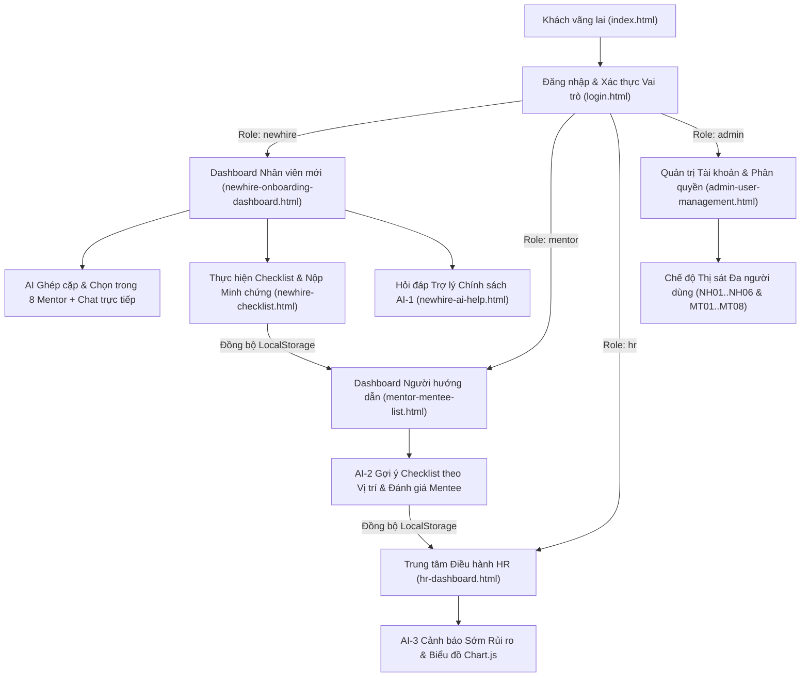

# PHÂN TÍCH VAI TRÒ, LUỒNG NGƯỜI DÙNG & TÍNH NĂNG AI (ROLES & FEATURES)

> **Dự án:** BTL-20 – **OnboardAI – Hành trình hội nhập nhân sự mới**  
> **Tài liệu chuẩn theo Mục 3.2, 3.7, 3.8, 3.9 – Hướng dẫn thực hiện BTL CSE122**

---

## 1. Phân tích các Vai trò Người dùng (10 Câu hỏi Bắt buộc – Mục 3.2)

Hệ thống **OnboardAI** được thiết kế cho **4 vai trò nghiệp vụ chính** (*Nhân viên mới, Người hướng dẫn, Chuyên viên HR, Quản trị viên*) cùng nhóm *Khách vãng lai (Visitor)* tại trang giới thiệu.

### 1.1. Vai trò 1: Nhân viên mới (New Hire)
1. **Người này là ai?** Nhân sự mới gia nhập doanh nghiệp đang trong giai đoạn thử việc 60 ngày (`NH01` $\rightarrow$ `NH06`).
2. **Mục tiêu chính là gì?** Hoàn thành đúng hạn lộ trình hội nhập, nắm vững quy chế công ty và kết nối với Người đồng hành (Mentor).
3. **Họ cần xem dữ liệu gì?** Tiến độ hội nhập cá nhân (`%`), danh sách công việc theo 4 giai đoạn (*Ngày đầu, Tuần 1, Tháng 1, Tháng 2*), hồ sơ 8 Người đồng hành và kho tri thức chính sách công ty.
4. **Họ tạo dữ liệu gì?** Nộp minh chứng hoàn thành công việc (link tài liệu + ghi chú), gửi tin nhắn trao đổi với Mentor và đặt câu hỏi cho Trợ lý AI-1.
5. **Họ sửa gì?** Cập nhật trạng thái công việc, đổi Người đồng hành khi cần và cập nhật hồ sơ cá nhân (`profile.html`).
6. **Họ có thể hủy/xóa/khóa gì?** Đặt lại bộ lọc tìm kiếm, hủy thao tác nộp minh chứng khi chưa lưu hoặc bỏ qua gợi ý AI.
7. **Họ cần tìm kiếm/lọc gì?** Lọc công việc theo giai đoạn, trạng thái (`Chưa hoàn thành`, `Đã hoàn thành`, `Quá hạn`), tìm kiếm câu hỏi chính sách theo từ khóa.
8. **Họ cần dashboard nào?** Bảng điều khiển hội nhập cá nhân (`newhire-onboarding-dashboard.html`).
9. **AI hỗ trợ họ ở đâu?** AI đề xuất độ phù hợp (`Match Score %`) với 8 Người đồng hành, hướng dẫn làm từng nhiệm vụ (AI Guide/Quiz) và giải đáp quy chế 24/7 (`newhire-ai-help.html`).
10. **Họ tương tác với vai trò khác như thế nào?** Nhận nhiệm vụ và phản hồi từ **Mentor**, gửi phiếu hỏi trực tiếp tới **HR** khi cần hỗ trợ đặc biệt.

---

### 1.2. Vai trò 2: Người hướng dẫn (Mentor / Buddy)
1. **Người này là ai?** Các trưởng nhóm kỹ thuật, chuyên gia giàu kinh nghiệm (`MT01` $\rightarrow$ `MT08`) được phân công kèm cặp nhân sự mới.
2. **Mục tiêu chính là gì?** Kèm cặp chuyên môn, theo dõi sát tiến độ của các Mentee đang phụ trách và đánh giá định kỳ.
3. **Họ cần xem dữ liệu gì?** Danh sách Mentee mình phụ trách, tỷ lệ hoàn thành công việc, các đầu việc bị quá hạn và lịch sử đánh giá 1-on-1.
4. **Họ tạo dữ liệu gì?** Giao thêm nhiệm vụ chuyên môn mới, tạo phiếu ghi nhận đánh giá định kỳ 1-on-1 và gửi phản hồi/nhắc nhở cho Mentee.
5. **Họ sửa gì?** Chỉnh sửa danh sách công việc do AI-2 gợi ý trước khi giao cho Mentee, cập nhật điểm đánh giá năng lực.
6. **Họ có thể hủy/xóa/khóa gì?** Loại bỏ các đầu việc không phù hợp khỏi danh sách gợi ý AI trước khi lưu.
7. **Họ cần tìm kiếm/lọc gì?** Tìm kiếm Mentee theo tên/vị trí, lọc Mentee theo trạng thái (`Đúng tiến độ`, `Cần chú ý`, `Nguy cơ trễ hạn`).
8. **Họ cần dashboard nào?** Bảng điều khiển quản lý Mentee (`mentor-mentee-list.html`).
9. **AI hỗ trợ họ ở đâu?** **AI-2 (Checklist Personalizer)** tự động sinh danh sách công việc theo vị trí chuyên môn của Mentee và tóm tắt tiến độ trước buổi họp 1-on-1.
10. **Họ tương tác với vai trò khác như thế nào?** Kèm cặp, duyệt minh chứng và chat trực tiếp với **New Hire**; phối hợp với **HR** khi Mentee có nguy cơ trễ hạn.

---

### 1.3. Vai trò 3: Chuyên viên Nhân sự (HR Specialist)
1. **Người này là ai?** Chuyên viên bộ phận People & Culture (`hr@onboardai.vn`, `huy.pham@onboardai.vn`) điều phối toàn bộ chương trình Onboarding của công ty.
2. **Mục tiêu chính là gì?** Giám sát tỷ lệ hội nhập thành công toàn công ty, phát hiện sớm nhân sự có nguy cơ nghỉ việc/trễ hạn để can thiệp kịp thời.
3. **Họ cần xem dữ liệu gì?** Thống kê KPI toàn công ty, biểu đồ tiến độ theo phòng ban (`Chart.js`), danh sách cảnh báo rủi ro AI-3 và thư viện tài liệu nội bộ.
4. **Họ tạo dữ liệu gì?** Tạo thông báo nhắc nhở/can thiệp hỗ trợ nhân sự mới, thêm mới hoặc cập nhật tài liệu quy chế chuẩn.
5. **Họ sửa gì?** Điều chỉnh phân công Mentor – Mentee, cập nhật trạng thái hỗ trợ nhân sự.
6. **Họ có thể hủy/xóa/khóa gì?** Đóng/lưu trữ cảnh báo rủi ro sau khi đã xử lý xong.
7. **Họ cần tìm kiếm/lọc gì?** Lọc nhân sự theo phòng ban, mức độ rủi ro (`Tất cả`, `Đúng tiến độ`, `Nguy cơ trễ hạn`), tìm kiếm tài liệu quy chế.
8. **Họ cần dashboard nào?** Trung tâm điều hành HR (`hr-dashboard.html`).
9. **AI hỗ trợ họ ở đâu?** **AI-3 (Progress Risk Warning / Risk Radar)** dự báo nguy cơ trễ hạn thử việc, giải thích nguyên nhân và gợi ý phương án can thiệp.
10. **Họ tương tác với vai trò khác như thế nào?** Gửi thông báo can thiệp tới **New Hire** và **Mentor**, sử dụng **Chế độ thị sát (View-As)** để kiểm tra góc nhìn của từng nhân sự/mentor.

---

### 1.4. Vai trò 4: Quản trị viên Hệ thống (System Admin)
1. **Người này là ai?** Quản trị viên CNTT (`admin@onboardai.vn`, `son.do@onboardai.vn`) chịu trách nhiệm vận hành và bảo mật hệ thống.
2. **Mục tiêu chính là gì?** Quản lý vòng đời tài khoản người dùng, kiểm soát ma trận phân quyền RBAC và giám sát an toàn dữ liệu.
3. **Họ cần xem dữ liệu gì?** Danh sách toàn bộ tài khoản người dùng, chỉ số sức khỏe hệ thống (System Health Check), ma trận RBAC và Nhật ký kiểm toán (Audit Logs).
4. **Họ tạo dữ liệu gì?** Tạo tài khoản mới cho nhân sự/mentor/HR, tự động sinh email doanh nghiệp chuẩn hóa từ họ tên tiếng Việt.
5. **Họ sửa gì?** Thay đổi vai trò (Role) kèm xem trước sự thay đổi quyền hạn (Role Diff Preview), điều chuyển Mentee khi đổi vai trò Mentor.
6. **Họ có thể hủy/xóa/khóa gì?** Khóa/Mở khóa tài khoản (`Lock/Unlock`), xóa mềm có hoàn tác (`Soft Delete with Undo`), khôi phục cơ sở dữ liệu mẫu (`Reset Demo DB`).
7. **Họ cần tìm kiếm/lọc gì?** Tìm kiếm theo tên/email, lọc theo 4 vai trò, phòng ban, trạng thái tài khoản (`Active`, `Pending`, `Locked`).
8. **Họ cần dashboard nào?** Bảng quản trị tài khoản & phân quyền (`admin-user-management.html`).
9. **AI hỗ trợ họ ở đâu?** Kiểm tra tự động các xung đột cấu hình hệ thống (nhân sự thiếu Mentor, tài khoản chờ kích hoạt quá hạn, Mentor quá tải).
10. **Họ tương tác với vai trò khác như thế nào?** Cấp quyền cho toàn bộ **New Hire, Mentor, HR** và sử dụng **Chế độ thị sát đa người dùng (View-As)** để kiểm tra trải nghiệm thực tế của từng tài khoản.

---

## 2. Luồng Người dùng Tổng thể (User Flows)

---

## 3. Đặc tả 3 Tính năng AI & Trải nghiệm Khi AI Thất bại (Mục 3.7, 3.8, 3.9)

Dự án tích hợp **3 nhóm tính năng AI hoàn toàn khác nhau** (không phải 3 chatbot giống nhau), tuân thủ chặt chẽ luồng 7 bước của **Mục 3.8** và bao phủ trạng thái khi AI không chắc chắn theo **Mục 3.9**:

| Mã AI | Tên Tính năng & Nhóm AI | Luồng Trải nghiệm AI (Mục 3.8) | Giải thích Kết quả (Explainability) | Trải nghiệm khi AI Thất bại / Không chắc chắn (Mục 3.9) |
| :--- | :--- | :--- | :--- | :--- |
| **AI-1** | **Trợ lý Chính sách & Tìm kiếm Ngữ nghĩa** *(Nhóm: Tìm kiếm ngữ nghĩa + Giải thích)* Tệp: `newhire-ai-help.html` | 1. Nhập câu hỏi chính sách $\rightarrow$ Kiểm tra rỗng. 2. Hiển thị hiệu ứng AI đang phân tích. 3. Trả về câu trả lời định dạng rõ ràng kèm điều khoản gốc. | Hiển thị **Độ tin cậy (Confidence Score %)**, trích dẫn đúng **Mã tài liệu & Điều khoản** trong Sổ tay Nhân sự. | **3 vùng phản hồi (Zone 1/2/3):** • Khi câu hỏi mơ hồ (Zone 2): AI báo *"AI chưa chắc chắn về ý định của bạn"* và đưa ra các gợi ý làm rõ. • Khi ngoài phạm vi dữ liệu (Zone 3): AI báo *"Không đủ dữ liệu chính sách để trả lời chính xác"* kèm nút **[Chuyển câu hỏi cho HR]** (dùng thủ công). |
| **AI-2** | **Ghép cặp Người đồng hành & Sinh Lộ trình** *(Nhóm: Ghép cặp + Sinh nội dung)* Tệp: `newhire-onboarding-dashboard.html`, `mentor-task-assignment.html` | 1. Phân tích hồ sơ phòng ban & vị trí của nhân sự mới. 2. Tính điểm tương thích với 8 Mentor & gợi ý danh sách đầu việc. 3. Cho phép **Chấp nhận / Đổi người khác / Chỉnh sửa đầu việc** trước khi lưu. | Giải thích rõ **Vì sao Mentor này phù hợp** (`98% Phù hợp`: Cùng phòng Kỹ thuật, chuyên môn Frontend/System, còn slot kèm cặp). | • Nếu nhân sự mới chưa muốn chọn theo gợi ý đầu tiên, có thể bấm **[Xem toàn bộ 8 Người đồng hành]** để tự so sánh và chọn thủ công hoặc đổi Mentor bất kỳ lúc nào. |
| **AI-3** | **Dự báo & Cảnh báo Sớm Rủi ro Hội nhập** *(Nhóm: Dự báo + Phân loại mức ưu tiên)* Tệp: `hr-dashboard.html` | 1. Quét dữ liệu tiến độ, số task quá hạn và số ngày thử việc. 2. Phân loại nhân sự vào nhóm `Đúng tiến độ`, `Cần chú ý`, `Nguy cơ trễ hạn`. 3. HR chọn phương án can thiệp và lưu vào hệ thống. | Giải thích rõ **Nguyên nhân rủi ro** (VD: *"Tiến độ đạt 25% sau 3 tuần, có 2 nhiệm vụ bắt buộc quá hạn"*). | • Cho phép HR bấm **[Mở ngăn kéo Can thiệp]** để chỉnh sửa nội dung tin nhắn nhắc nhở thủ công, đổi Mentor hoặc bỏ qua cảnh báo nếu đã xác minh trực tiếp. |
